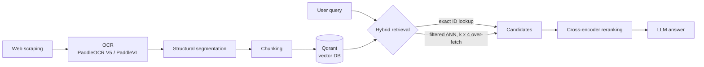

<!-- Header banner -->

 

---

## 👋 About me

MSc student in **Artificial Intelligence, Data & Agentic Systems** at **Université Paris Dauphine**, with a strong foundation in applied mathematics (BSc MIDO, 2022–2025).
I design and ship **LLM-powered systems**: from OCR and chunking to hybrid retrieval, reranking and autonomous agents.

> 🎯 **Currently seeking:** a 6-month end-of-studies internship as an **AI Engineer**, starting **February 2027** (LLMs, Generative AI, autonomous agent frameworks).

---

## 🗺️ Project roadmap

My journey from mathematical foundations to agentic systems:

  

| Stage | Project | Focus | Status |
|:--:|---|---|:--:|
| 1 | Applied Maths & CS degree (MIDO) | Linear algebra, probability, algorithms, SQL, Java | ✅ Done |
| 2 | **Eruditio** + Mini-GPT | Transformers, self-attention, LLMs from scratch | In progress ⏳ |
| 3 | **SELMA** (EY & Dauphine Hackathon) | ETL, risk scoring, GLMs, DeepONet | ✅ Done |
| 4 | **Quant Finance Agentic RAG** | LangChain, Qdrant, cointegration, HMM | ✅ Done |
| 5 | **Ooredoo** and **Vermeg** internships | Production RAG, OCR, Spring Boot, rule engines | ✅ Done |
| 6 | End-of-studies internship (Feb 2027) | LLMs, GenAI, autonomous agents | 🔭 Next |

---

## 🧠 What I work with

<b>🔎 Click to expand: skills by category</b>

| Category | Technologies |
|---|---|
| **Languages** | Python, Java, SQL (MySQL), R, VBA |
| **AI / ML / Data** | PyTorch, TensorFlow, Scikit-Learn, Pandas, NumPy, LangChain, NLP, RAG, Transformers, PaddleOCR |
| **Frameworks** | Spring Boot, Angular, FastAPI, Streamlit |
| **Tools & Databases** | Git, Qdrant (vector DB), Maven, Obsidian |
| **Spoken languages** | 🇹🇳 Arabic (native) · 🇫🇷 French (full professional) · 🇬🇧 English (full professional) |

---

## 🚀 Featured projects

<b>📈 Quantitative Finance Agentic RAG System</b>

 

An autonomous **Agentic RAG** pipeline that retrieves and analyzes financial reports alongside real-time market data.

- Integrates **statistical arbitrage** into the agent's reasoning: S&P 500 **cointegration testing** and **Hidden Markov Model** regime classification
- **Stack:** `Python` `LangChain` `Qdrant` `yFinance` `Scikit-Learn` `Streamlit`

<b>🛡️ Smart Insurance AI: SELMA Platform</b> · EY & Dauphine Hackathon

 

- **ETL pipeline** turning raw heterogeneous data into structured variables, mapping micro-business profiles to **sectoral risk scores**
- Classical models (**Logistic Regression**, **Gamma Regressor**) for claim frequency/severity, plus a **DeepONet** neural network for uncertainty analysis
- **Stack:** `Python` `PyTorch` `Scikit-Learn` `FastAPI` `Streamlit`

<b>📚 Eruditio: NLP Repository & Mini-GPT</b> · Open Source

 

- Educational repository documenting core NLP architectures, from foundational models to **Transformers and Self-Attention**
- A custom **Mini-GPT** trained **from scratch**, implementing multi-head attention and transformer blocks
- **Stack:** `Python` `TensorFlow` `PyTorch` `NumPy` `Git`

---

## 🏗️ How I architect a RAG pipeline

A simplified view of the pipeline I built during my Generative AI internship at Ooredoo:

---

## 💼 Experience

<b>🤖 Generative AI Engineer Intern</b> · Ooredoo (Marketing & Strategic Dept.), Tunis · <i>Jul–Aug 2026</i>

 

- Built an **end-to-end RAG chatbot pipeline**: web scraping, OCR, structural segmentation, chunking and vectorization into **Qdrant**
- Extracted complex structures (tables, charts, diagrams) using **PaddlePaddle** open-source OCR models (OcrV5 and PaddleVL)
- Architected a **hybrid retrieval** strategy: exact ID lookup, filtered ANN with k×4 over-fetching, and **cross-encoder reranking**

<b>⚙️ Backend Engineer Intern</b> · Vermeg (Banking & Insurance Software), Tunis · <i>Jul–Aug 2026</i>

 

- Engineered an **AWR report analysis engine** to automate database bottleneck detection and performance diagnostics
- Full-stack architecture with **Spring Boot, Angular and Maven** to parse, process and visualize database metrics
- Custom **fuzzy-logic rule engine** to classify performance anomalies

---

## 🎓 Education

| Period | Program | Institution |
|---|---|---|
| 2025 – Present | **MSc Artificial Intelligence, Data & Agentic Systems** | Université Paris Dauphine |
| 2022 – 2025 | **BSc Applied Mathematics & Computer Science (MIDO)** | Université Paris Dauphine |

<b>📖 MSc coursework</b>

Machine Learning · Deep Learning · Big Data · NLP · Generative AI & LLMs · Computer Vision · DBMS (MySQL, NoSQL) · Reinforcement Learning · AI on Cloud

---

## 📊 GitHub stats

---

## 📫 Let's connect

I'm open to **AI Engineer / LLM / agentic systems** opportunities for **February 2027**.

